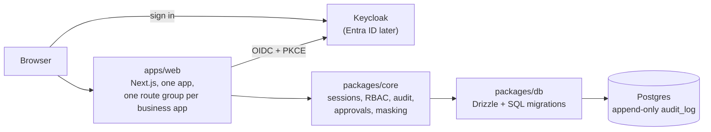

# fintech-internal-tools

Video walkthrough: https://www.loom.com/share/956688745216494988acfed0f11fcc13

A working proof of concept: the client's internal business apps (KYC review, refunds,
feature flags) rebuilt on a small shared platform, written with Devin. It exists to
answer one question with evidence instead of slides.

## The question: build or buy

The client runs its internal tools on Microsoft Power Apps. Client-supplied figures
(not independently sourced): about $250K a year, about 60 engineers, 3 apps today and
10+ planned. The question is whether to keep paying for Power Apps or to build and run
the apps on a shared platform, with Devin doing most of the build.

Research with sourced prices, limits and compliance needs: [docs/research/research.md](docs/research/research.md).
Per-app requirements (unvalidated assumptions): [docs/research/requirements.md](docs/research/requirements.md).

## Run it

You need Docker. From the repo root:

```bash
docker compose up --build
```

This starts Postgres, Keycloak and the web app, then runs the migrations and seed.
Open http://localhost:3000 and sign in as one of the demo users below.

To work on the code with hot reload, lint and tests, see the command table in
[AGENTS.md](AGENTS.md#3-commands).

## Demo users

All passwords are `demo-only-change-me` (fake, local only).

| User | Roles | Use it to |
|---|---|---|
| `analyst` | analyst | Request refunds; sees customer data masked |
| `approver` | approver | Approve or reject requests; reveal masked fields with a reason |
| `senior` | analyst + approver | Show that nobody can approve their own request |
| `admin` | admin | Read the audit log; no approve or reveal rights |
| `norole` | none | Show that a signed-in user with no role sees nothing |

## What's real and what's mocked

| Real | Mocked or missing |
|---|---|
| OIDC sign-in (authorization code + PKCE) against a real identity provider | Keycloak stands in for Entra ID. No real Entra tenant has been tested |
| Permission checks on the server for every page, action and route | All data is fake and seeded. No real customer data or secrets |
| Audit row written in the same transaction as every change; the database blocks edits and deletes of audit rows | The card provider is a mock (`mock_provider_refunds` table). No money moves |
| Maker-checker approvals; masking on the server, with an audited, rate-limited reveal | No hosting, deploy pipeline, environments, monitoring or alerting |
| The refunds and KYC review apps, with tests on real Postgres and end-to-end tests in CI | No email or Teams notifications; no Power Apps data migration |
| | KYC cases and documents are seed data only: no case intake or document upload yet |
| | Feature flags is still an open PR (see #24), not on `main` |

## Architecture



In ten lines:

1. One Next.js app (`apps/web`). Each business app is its own route group.
2. Sign-in is OIDC with PKCE: Keycloak locally, Entra ID later. Sessions live in Postgres.
3. Roles come from the identity provider's `roles` claim.
4. Every page, server action and route checks permissions on the server. Hiding a button is never the control.
5. Permissions are listed in one registry in `packages/core`, which only a code owner can change.
6. Every change to business data writes an audit row in the same transaction.
7. A database trigger blocks updates and deletes on the audit log.
8. The app connects as a least-privilege database role. Migrations use a separate owner role.
9. Approvals are maker-checker: whoever makes a request can't approve it.
10. Sensitive fields are masked on the server. Revealing one needs a reason, is rate-limited and is audited.

Full detail, data flow and known gaps: [docs/ARCHITECTURE.md](docs/ARCHITECTURE.md).
How to add an app: [docs/ADDING-AN-APP.md](docs/ADDING-AN-APP.md).

## How it was built with Devin

Each piece was built in a Devin session: one branch and one PR per session, following
the rules in [AGENTS.md](AGENTS.md). New apps follow the
[new-internal-tool playbook](docs/playbooks/new-internal-tool.md), with refunds as the
reference. Devin Review checks every PR against [REVIEW.md](REVIEW.md).

The [dev log](docs/DEVIN-LOG.md) has one row per session: what was asked, how long it
took, what it cost, what went wrong and what was corrected.

## Governance and security

- [docs/GOVERNANCE.md](docs/GOVERNANCE.md): branch protection, code owners, required
  checks, and what Devin may merge itself. Changes to core, migrations, playbooks and
  `.github/` need a human.
- [docs/SECURITY-REVIEW.md](docs/SECURITY-REVIEW.md): core and refunds attacked across
  12 areas. Three attacks worked. Each got a failing test first and then a fix, followed
  by a hardening pass.

## Recommendation

See [KEY-DECISIONS.md](KEY-DECISIONS.md) and the deck, [docs/submission/deck.pdf](docs/submission/deck.pdf).
