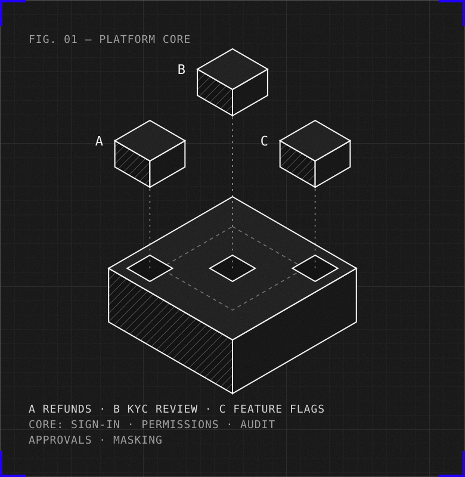

<!-- _class: title -->
<!-- _paginate: skip -->

# Power Apps or build with Devin?

Build with Devin in phases, refunds dashboard first

<!-- _footer: "Thomas Pritchard · Prepared for the VP of Engineering · October 2026" -->

<!--
You asked whether your team can use Devin to build your internal tools instead of paying for Power Apps. Short answer: yes, build, but in phases, starting with the refunds dashboard, and keep the KYC queue on Power Apps for now. Here's why, in under five minutes.
-->

---

<!-- _class: long allow-title-wraps allow-bullet-too-long allow-orphan-word allow-unused-space -->
<!-- _footer: "Source: Microsoft pricing and Microsoft Learn; licensing advisors on the 2027 price rise; see A1 and A2" -->

# Power Apps secures the platform, not each app's own controls

- Today: $250K a year, approx. 1,000 users at $20 a month each (our estimate)
- 2027: approx. $275K; the 10+ new tools add no licence cost
- Real value: the bottom two layers, and ops editing their own apps

<small>What the licence covers</small>
Build: canvas and model-driven apps

Logic: Power Fx and Power Automate

Connectors: 1,000+, Teams and Outlook

Data: Dataverse, row security, audit

Governance: Entra, data loss rules, SOC 2 and ISO

<small>Left to each app to build</small>
Blocking self-approval

Hiding customer data

An exportable audit trail

<!--
Today you run three tools on Power Apps: the KYC review queue, the refunds dashboard and the feature-flag admin. We don't know your seat count, but at the $20 list price your $250K is about 1,000 users, so most of them are ops, compliance and support, not engineers.
Power Apps is priced per person with unlimited apps, so the ten new tools add no licence cost. But a price rise to about $275K is reported for 2027.
What you really pay for is governance: Entra sign-in, data loss rules, Dataverse security and Microsoft's compliance scope, and ops can change their own apps without engineering.
Power Apps secures the platform. But whether each app is compliant, blocking self-approval, masking customer data, keeping an audit trail, depends on whoever built that app, every time. With three apps that's manageable. With thirteen, it's a risk.
-->

---

<!-- _class: long allow-title-wraps allow-bullet-too-long allow-orphan-word allow-too-many-bullets -->
<!-- _footer: "Source: this repo, docs/DEVIN-LOG.md and docs/SECURITY-REVIEW.md; see A3" -->

# One core platform, lightweight tools on top

- Refunds first, with an engineer steering; Devin then wrote the playbook
- KYC queue and flag admin from the playbook: one Devin session each, under $10 each
- A separate Devin session attacked the build: 4 holes found, all fixed before merge
- Every change is a pull request, gated by tests, Devin Review and code owners

Refunds dashboard

KYC review queue

Feature-flag admin

Next 10 tools, from the playbook

Core platform, built once by Devin

Sign-in

Permissions

Approvals

Data masking

Audit

Key rules also enforced in the database

<!--
So here's the alternative: one core platform that holds every control, and lightweight tools on top that only carry their own business logic. Devin built the core once. I steered the refunds dashboard, Devin turned that session into a playbook, and the KYC queue and flag admin were one session each from it, under ten dollars each. Then a separate Devin session attacked the build: four holes, all fixed before merge. Every change went through a pull request with tests and review.
-->

---

<!-- _class: divider demo allow-paragraph allow-number-without-source allow-unused-space allow-off-left-edge -->
<!-- _paginate: skip -->
<!-- _footer: "" -->

# Three tools.

One core platform.

<!--
Switch to the browser. Refunds as Sam (masking, reveal with a reason, request, blocked self-approval), then KYC (claim, approve, needs a second sign-off; escalate), then flags (prod change needs approval; kill switch). Sign out, sign in as admin, audit log and export. Then: built the way you'd build it for production; going live is integration work, not a rewrite.
-->

---

<!-- _class: long big allow-title-wraps -->
<!-- _footer: "Source: Microsoft Learn; our build and security review; see A2 and A3" -->

# Most of it is replicable with Devin; the risk is owning it

| Replicable with Devin | Hard to replicate | Where the risk is |
|---|---|---|
| Screens, queues and forms | Microsoft's SOC 2 and ISO scope | You own on-call, upgrades and security |
| Approvals, masking and audit | Ops editing apps without engineers | AI-written code needs tests and review |
| Tests and Git history | 1,000+ connectors, Teams, Outlook | Moving data and retraining users |

<!--
Most of what your three tools do is replicable with Devin: screens, queues, approvals, masking, audit and proper testing. In some places, like self-approval and audit export, the build is stronger than Power Apps.
What's hard to replicate is the platform around it: Microsoft's compliance scope, ops editing their own apps, 1,000+ connectors, Teams and Outlook.
The real risk isn't the build. It's that you now own it: on-call, upgrades, security testing, and reviewing AI-written code. That's engineering time away from your product, so it has to be worth it.
-->

---

<!-- _class: long allow-title-wraps allow-bullet-too-long allow-orphan-word -->
<!-- _footer: "Source: Microsoft pricing; Devin billing docs; Devin usage, 16 Oct; every build number an estimate; see A4" -->

# Building runs approx. $85K to $190K a year, vs $275K for Power Apps

- One-off cost to move: approx. $75K to $200K
- Then saves approx. $85K to $190K a year; pays back in 1 to 2.5 years
- Devin: approx. $100 built all three prototypes

| Yearly, once running | Estimate |
|---|---|
| Half to one engineer owning it | $70K to $140K |
| Hosting, monitoring, pen test | $10K to $28K |
| Devin seats and usage | $6K to $22K |
| Total per year | approx. $85K to $190K |
| Power Apps, 2027 price | approx. $275K |

<!--
Here's the honest money. Once teams have moved, running the platform costs about $85K to $190K a year: mostly half to one engineer owning it, plus hosting, a yearly pen test and Devin. Power Apps for the same people is about $275K from 2027.
Getting there costs $75K to $200K once, for real sign-in, the payment provider, moving data off Dataverse, testing with ops and training.
And seats only drop when a whole team stops using Power Apps, so year one saves little. The saving comes in years two and three.
Devin itself is the small part: about $100 built all three prototypes. Production builds cost more, but people are most of the bill.
-->

---

<!-- _class: plan long allow-title-wraps -->
<!-- _footer: "Source: our build and assessment; see A4 for costs and gaps" -->

# Build in phases: refunds dashboard first, new tools from the playbook

<small>Weeks 1 to 2</small>Discovery with your team: apps, connectors, compliance, seats<small>Gate: savings known</small><small class="devin">Devin: documents your current apps</small>

<small>Weeks 3 to 12</small>Refunds to production, alongside the Power App<small>Gate: results match, ops sign off</small><small class="devin">Devin: builds and tests from the playbook</small>

<small>Months 3 to 6</small>Switch refunds; next tools from the playbook<small>Gate: each tool on budget</small><small class="devin">Devin: one session per tool, in parallel</small>

<small>After 6 months</small>KYC after compliance sign-off; buy a flag product<small>Gate: auditor sign-off</small><small class="devin">Devin: scheduled upkeep and security reviews</small>

Stop at any gate if it needs more than one engineer. Staying on Power Apps? Devin still writes tests and migrations. Next step: a working session on your stack.

<!--
So my recommendation is build, but in phases, and you can stop at any gate.
First two weeks: discovery with your team, finding out who uses which app and connector, your compliance needs, unused seats and your renewal date. That saves money whatever you decide.
Then 90 days to take the refunds dashboard to production, with your real Entra sign-in, your payment provider, a pen test and testing with ops, running alongside the Power App until the results match.
Then switch refunds over and build the next planned tools from the playbook.
KYC moves only once compliance signs off, and for feature flags I'd buy a dedicated tool rather than maintain ours.
If ownership ever needs more than one engineer, stop and keep Power Apps for the rest. And if you decide to stay on Power Apps, Devin still helps with automated testing and data migration.
Next step: a working session on your stack.
-->

---

<!-- _class: divider allow-paragraph allow-number-without-source allow-unused-space -->
<!-- _paginate: skip -->
<!-- _footer: "" -->

# Appendix

Reference for after the call: A1 Licensing · A2 Controls · A3 Build evidence · A4 Cost detail · A5 Sources

<!--
Appendix divider. Not presented; the appendix is for reading afterwards.
-->

---

<!-- _class: appendix pg-i dense -->
<!-- _footer: "Source: Microsoft pricing and Microsoft Learn; licensing advisors on notice MC1470566; see A5" -->

# A1 · Licensing

| | |
|---|---|
| Premium | $20 per user per month with unlimited apps. The $12 tier needs 2,000 seats, so it doesn't apply |
| Seats | $250,000 / $240 = 1,042 implied seats at list price. Same seats in 2027 at $22: $275,088 |
| Price rise | To $22 from 1 Jan 2027, notice MC1470566. Reported by four licensing advisors; Message Center only |
| Per app | On the same seats: $83K per app at 3 apps, $19K at 13. Each extra app costs $0 |
| Pay-as-you-go | $10 per active user per app per month (licensing advisors; not on Microsoft's public page). Saves $144 a year for one-app users at 2027 prices |
| Enforcement | From Feb 2027, in managed environments only. Every user who runs an app needs a licence; Premium, per-app passes, pay-as-you-go and trials all count |
| Admin check | The "Users requiring licenses in Managed Environments" report. Seats can only be reduced at renewal |

<!--
A1 Licensing. Reference for slides 1 and 4.
-->

---

<!-- _class: appendix pg-ii dense -->
<!-- _footer: "Source: Microsoft Learn; docs/SECURITY-REVIEW.md; see A5" -->

# A2 · Controls, Power Apps vs our build

| | Power Apps | Our build | Our remaining gaps |
|---|---|---|---|
| Self-approval | Not documented as built in; the requester field is optional free text | Blocked in code and by a database rule | None known |
| Masking | Column security, but data is never hidden from system administrators | Masked on the server; reveal needs a reason, 20 per user per hour, audited | Database owner sees raw rows |
| Audit | History kept; exporting audit logs isn't supported | Append-only, written in the same transaction; denials and reveals audited; CSV export | No tamper-evident hash chain |
| Identity | Entra, Conditional Access, Managed Environments | Standard sign-in, with Keycloak standing in for Entra | Role removal applies at next sign-in |
| Scale | Some queries read only 500 rows and return incorrect results | SQL over Postgres | None known |
| Change control | Test Engine deprecated; canvas Git removed | Code owners, required CI, tests written before code | Merge queue off |
| Retention | Retention policies | KYC cases kept 5 years by a database rule (UK MLR 2017 reg 40) | Auditor acceptance untested |

<!--
A2 Controls, Power Apps vs our build, with our own remaining gaps. Reference for slides 1 and 3.
-->

---

<!-- _class: appendix pg-iii dense stack allow-paragraph allow-unused-space -->
<!-- _footer: "Source: this repo, GitHub PRs, CI on main; Devin usage page, 16 Oct; see A5" -->

# A3 · Build evidence

| | Refunds dashboard | KYC review queue | Feature-flag admin |
|---|---|---|---|
| Business logic | 585 lines | 566 lines | 542 lines |
| How it was built | Engineer steering Devin | GitHub issue and playbook, one session | GitHub issue and playbook, one session |
| Devin cost | $23.94 | $7.30 | $8.26 |
| Tests written to fail first | 30 of 34 | Not logged | 52 of 62 |
| Attacks that worked, all fixed | Bulk unmasking, splitting a refund, unlogged denials | None | Unlogged service denials |

Whole build: 401 tests plus 8 end-to-end, all passing; every pull request opened by Devin. Devin spend $132.27 in total, including $33.87 for the shared platform, $9.85 security review, $8.75 UX polish, $14.10 fixes and $21.62 on this deck and docs. My own review time, not logged, is estimated at 8 to 12 hours.

<!--
A3 Build evidence. Reference for slide 2.
-->

---

<!-- _class: appendix pg-iv dense -->
<!-- _footer: "Source: cloud and pen-test pricing from vendors and advisors; Devin billing docs; every number an estimate; see A5" -->

# A4 · Cost detail and what production needs

| Item | Estimate | Basis |
|---|---|---|
| Engineer owning it, yearly | $70K to $140K | 0.5 to 1 engineer at $140K loaded London cost |
| Hosting and monitoring, yearly | $5K to $16K | Small cloud setup with backups, firewall and alerts |
| Pen test, yearly | $5K to $12K | £3.5K to £6.5K per test, plus fixes and retest |
| Devin, yearly | $6K to $22K | 5 Teams seats at $40 a month; builds; nightly maintenance runs capped at $40 a night |
| Integrations, once | $18K to $36K | Entra, payment provider, document storage: 6 to 12 engineer-weeks |
| Data migration, once | $15K to $50K | Moving records and history off Dataverse |
| Testing with ops and cutover, once | $30K to $75K | Running alongside the Power App, then 2 to 6 weeks of support |
| Training, once | $10K to $40K | Only users of tools that move |
| Not counted | Today's Power Apps admin and maker time | Ask the client; it narrows the gap further |

<!--
A4 Cost detail behind slide 4, and what production needs. Every number is an estimate.
-->

---

<!-- _class: appendix pg-v dense sources1 allow-too-many-bullets allow-text-too-small allow-orphan-word allow-unused-space -->
<!-- _footer: "Source: as listed; all read 14 to 16 Oct 2026" -->

# A5 · Sources

<ol class="sources">
<li>Power Apps pricing (Microsoft)<small>microsoft.com/power-platform/products/power-apps/pricing</small></li>
<li>Managed environment licensing (Microsoft Learn)<small>learn.microsoft.com/power-platform/admin/managed-environment-licensing</small></li>
<li>Managed environments overview (Microsoft Learn)<small>learn.microsoft.com/power-platform/admin/managed-environment-overview</small></li>
<li>Approvals connector (Microsoft Learn)<small>learn.microsoft.com/connectors/approvals</small></li>
<li>Dataverse security and column security (Microsoft Learn)<small>learn.microsoft.com/power-platform/admin/wp-security-cds</small></li>
<li>Auditing (Microsoft Learn)<small>learn.microsoft.com/power-platform/admin/audit-data-user-activity</small></li>
<li>Data loss prevention (Microsoft Learn)<small>learn.microsoft.com/power-platform/admin/wp-data-loss-prevention</small></li>
<li>Delegation, 500-row limit (Microsoft Learn)<small>learn.microsoft.com/power-apps/maker/canvas-apps/delegation-overview</small></li>
<li>Test Engine and Git integration (Microsoft Learn)<small>learn.microsoft.com/power-platform/test-engine/overview</small></li>
<li>SOC 2 offering (Microsoft Learn)<small>learn.microsoft.com/compliance/regulatory/offering-soc-2</small></li>
<li>2027 price rise and enforcement (SAMexpert, third party)<small>samexpert.com/power-apps-2027-enforcement-price-increase</small></li>
<li>Per-app plan and pay-as-you-go (SAMexpert, third party)<small>samexpert.com/power-apps-per-app-plan-retired</small></li>
<li>2027 price rise (2Data, third party)<small>2-data.com/knowledge-hub (Power Apps Premium price rise)</small></li>
<li>Devin billing and enterprise security (Cognition)<small>docs.devin.ai/admin/billing</small></li>
<li>UK MLR 2017, regulation 40 (legislation.gov.uk)<small>legislation.gov.uk/uksi/2017/692/regulation/40</small></li>
<li>This build: repo, CI and Devin usage page (measured)<small>github.com/tompritch30/fintech-internal-tools; docs/research, docs/submission/EVIDENCE.md, docs/SECURITY-REVIEW.md</small></li>
</ol>

<!--
A5 Sources on one page. Everything else lives in the repo docs.
-->
