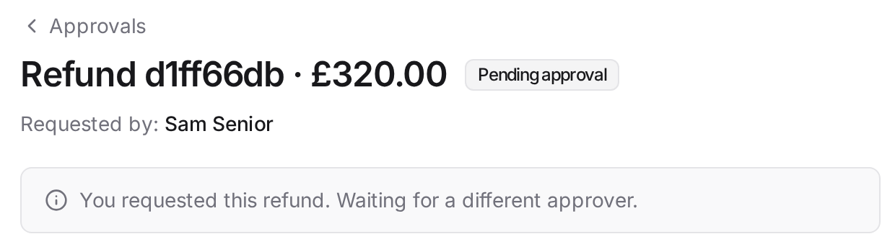
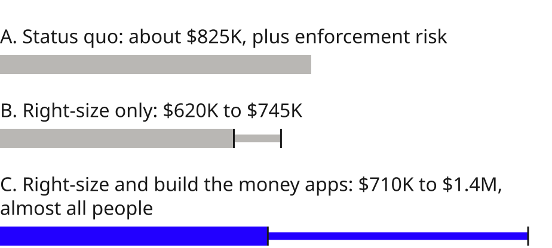

<!-- _class: title -->
<!-- _paginate: skip -->

# Power Apps or build with Devin?

Build the money apps with Devin; keep Power Apps for the rest

<!-- _footer: "Prepared for the VP of Engineering · October 2026" -->

<!--
You asked whether to keep paying for Power Apps or build. Short answer: yes, use Devin, but for the apps that move money, not all thirteen. Here's why, in under five minutes.
-->

---

<!-- _class: long allow-title-wraps allow-bullet-too-long -->
<!-- _footer: "Source: Microsoft pricing page; licensing advisors on notice MC1470566; see A1" -->

###### 01 · The scene

# Going from 3 to 13 internal apps makes this a platform decision, not a licence one

- Today: 3 apps on about 1,042 Premium seats, $250K a year
- Next: 10+ more planned, and refunds and KYC are regulated (four-eyes, masking, audit)
- 2027: a reported rise to about $275K, and unlicensed users blocked

60 engineers

<small>2026</small>$250K

<small>2027, reported</small>about $275K

<!--
Today you run three apps on about a thousand seats, and you have sixty engineers, so most of those seats are ops, compliance and support. Premium is per person with unlimited apps, so the next ten apps are free on those seats, but moving one app frees no seat until everything that person uses has moved. Two things land in 2027: a reported two dollar rise, about 25K a year at your seat count, and Microsoft blocking unlicensed users in managed environments. If everyone already holds Premium that's nothing; if some ride Microsoft 365 rights or trials, the bill grows. One admin report tells you. So the real question isn't the licence. It's where the next ten apps get built, and whether their controls stand up to an audit.
-->

---

<!-- _class: long allow-title-wraps allow-bullet-too-long -->
<!-- _footer: "Source: Microsoft Learn (Managed Environments, Approvals connector, column security, auditing); see A2" -->

###### 02 · Business value

# Build the apps that move money with Devin; keep Power Apps for workflow

- Real value: it sits inside the Microsoft boundary you already govern (Entra, data loss rules, Dataverse security, SOC 2 scope)
- The gaps sit where auditors look: self-approval left to each flow, admins see masked data, no audit export
- Cognition's role: not replacing Power Apps, but a factory for the apps engineers own

<small>Workflow and config</small><small>Money and identity</small>
<small class="row">Ops changes it</small>
Keep on Power Apps<small>checklists, vendor approvals</small>

Keep for now<small>KYC</small>

<small class="row">Engineering changes it</small>
Buy<small>feature flags: Unleash, LaunchDarkly</small>

Build with Devin<small>refunds, disputes, payouts</small>

<!--
Power Apps isn't just a form builder. For a regulated firm its value is the governance you already run: Entra sign-in with Conditional Access per app, Dataverse roles down to the column, data loss rules, Managed Environments, and Microsoft's SOC 2 and ISO scope. Ops can change their own apps without an engineering ticket, and for most of your thirteen apps that's the right home. The weak spots are where an auditor looks hardest: Microsoft doesn't document a built-in block on approving your own request, so every flow author has to build and test it; system administrators can see masked data; and audit logs can't be exported natively. So I'd sort apps by two questions: who changes it, and does it touch money or identity. Build only the bottom right with Devin. Buy flags, it's a solved problem. And for Cognition, Devin isn't a Power Apps replacement, it's the factory for that bottom right box: one core, a playbook per app, review and maintenance built in.
-->

---

<!-- _class: long allow-title-wraps allow-bullet-too-long -->
<!-- _footer: "Source: CI on main, 16 Oct; docs/SECURITY-REVIEW.md; see A3" -->

###### 03 · Demo

# Devin built three controlled apps in a day; the last two from a playbook

- Written once: sign-in, permissions, approvals, masking and audit, with key rules enforced in the database
- 401 tests plus 8 end-to-end; our own attack review broke 4 controls, all fixed
- Production-shaped, not production-ready: fake data, mock card provider, Keycloak standing in for Entra

refunds

KYC

flags

sign-in

permissions

approvals

masking

audit

<!--
Before the demo: Everything you'll see runs on one shared core. Devin built refunds with me steering, then KYC and flags each from a GitHub issue and a playbook, one session each.

After the demo: All 43 pull requests were opened by Devin. I set the rules, reviewed the core and ran a hostile review. Four attacks worked, and each got a failing test and a fix. The appendix lists what's still missing.
-->

---

<!-- _class: plan long allow-title-wraps allow-bullet-too-long -->
<!-- _footer: "Source: Devin Usage page, 16 Oct; Microsoft pricing; see A1 and A4" -->

###### 04a · Cost and plan

# Start with refunds: in production in 90 days, about $8 of Devin per app after that

- Devin was $106 for 3 apps: the first $24, then $7 to $8 each from the playbook
- The real cost is people: 0.5 to 1 engineer owning it, plus hosting, pen test, migration and training
- A working build strengthens your hand at both renewals: Microsoft (true-down) and Cognition (measured cost per app)

Status quo excludes today's Power Apps admin and maker time, which narrows the gap.

Devin is under 3% of option C; the rest is people and running costs.

<!--
Your CFO will look at three years, so here it is. Status quo is about 825K at the 2027 price. Right-sizing alone, cutting inactive seats and moving single-app users to pay-as-you-go, gets that to 620 to 745K with no code, so do it first whatever else you decide. Building adds cost, but it isn't Devin: 106 dollars for three apps, and the playbook cut the per-app cost to a third. The real cost is half to one engineer owning it, plus hosting, a yearly pen test, migration and training. So I'm not selling you a licence saving. I'm saying build with Devin where the controls are the product, in phases with gates: 30 days to right-size, 90 days to take refunds to production with your real Entra and payment provider, then app 4 from the playbook, and a kill criterion so you can stop at any gate. The working build also helps you negotiate, with Microsoft at renewal because true-down only happens then, and with Cognition because a measured cost per app earns a committed rate. Next step is 30 days with your Power Platform admin.
-->

---

<!-- _class: plan long allow-title-wraps -->
<!-- _footer: "Source: Devin Usage page, 16 Oct; Microsoft pricing; see A1 and A4" -->

###### 04b · Cost and plan

# The plan: four phases, each with a gate you can stop at

<small>Step 0, 0 to 30 days</small>Right-size and map users to apps (do this anyway)<small>Gate: saving quantified</small>

<small>30 to 90 days</small>Refunds to production with real Entra, payment provider, pen test, UAT and a parallel run<small>Gate: reconciles and ops sign‑off</small>

<small>90 to 180 days</small>Cut over refunds, app 4 from the playbook<small>Gate: at pilot cost or better</small>

<small>180 days on</small>Apps 5 to 13 sorted by the 2x2; KYC only after auditor sign-off<small>Gate: each app at pilot cost or better</small>

Kill criterion: stop if ownership goes over 1 engineer or review hours break the cap twice

<!--
(Narration for 04b is in the 04a notes, from "in phases with gates".)
-->

---

<!-- _class: appendix dense -->
<!-- _footer: "Source: Microsoft pricing and licensing pages; licensing advisors on notice MC1470566; see A5" -->

###### Appendix A1

# Licensing

| | |
|---|---|
| Premium | $20 per user per month with unlimited apps; the $12 tier needs 2,000 seats so isn't them |
| Pay-as-you-go | $10 per active user per app per month (third party, licensing advisors; not on Microsoft's public page) |
| Break even | one-app users save $144 a year at 2027 prices, two apps about parity, three or more cost more |
| Price rise | to $22 from 1 Jan 2027 per notice MC1470566 (reported by four licensing advisors, Message Center only) |
| Seats | implied seats $250,000 / $240 = 1,042; same seats in 2027 = $275,088; same budget in 2027 = 947 seats |
| Per app cost | on the same seats $83K at 3 apps, $19K at 13, marginal app $0 |
| Enforcement | Feb 2027 enforcement applies in managed environments only, to every user who runs an app, and Premium, per-app passes, pay-as-you-go and trials all qualify |
| Admin check | "Users requiring licenses in Managed Environments" report; true-down only happens at renewal |

<!--
A1 Licensing. Reference for slides 1 and 4.
-->

---

<!-- _class: appendix dense -->
<!-- _footer: "Source: Microsoft Learn; docs/SECURITY-REVIEW.md; see A5" -->

###### Appendix A2

# Controls, Power Apps vs our build

| | Power Apps | Our build | Our own remaining gaps |
|---|---|---|---|
| Self-approval | not documented as built in, Requestor is optional free text | blocked in code and by a database CHECK | none known |
| Masking | column security but data is never hidden from system administrators | masked on the server, reveal needs a 10+ character reason, 20 per user per hour, audited | DB owner sees raw rows, any kyc:read user can reveal within the limit |
| Audit | history kept, exporting audit logs isn't supported | append-only by trigger in the same transaction, denials and reveals audited, CSV export | no DB-level audit of business tables, no hash chain |
| Identity | Entra, Conditional Access, Managed Environments | OIDC with Keycloak standing in for Entra | role removal bites at next sign-in |
| Scale | non-delegable queries read 500 rows and return incorrect results | SQL over Postgres | none known |
| Change control | Test Engine deprecated, canvas Git removed | CODEOWNERS, required CI, 401 tests plus 8 end-to-end, red-first | merge queue off |
| Retention | retention policies | KYC kept 5 years by trigger per UK MLR 2017 reg 40 | auditor acceptance untested |

<!--
A2 Controls, Power Apps vs our build, with a column for our own remaining gaps. Reference for slide 2.
-->

---

<!-- _class: appendix dense stack allow-paragraph -->
<!-- _footer: "Source: repo, GitHub PRs #10, #22, #24; Devin Usage page, 16 Oct; see A5" -->

###### Appendix A3

# Build evidence

| | Refunds | KYC | Flags |
|---|---|---|---|
| Business logic lines | 585 | 566 | 542 |
| Migrations | 3 | 2 | 2 |
| Shown failing first | 30 of 34 | not in the log | 52 of 62 |
| Build route | built with me steering | GitHub issue and playbook, one session | GitHub issue and playbook, one session |
| Devin Review threads | 2 | 1 | 0 |
| Attacks that worked, all fixed | bulk unmask, refund split, prefetch denial audit | 0 broke | flags service denials |

Devin spend by session group, Usage page 16 Oct (US$): research 4.58, core and governance 33.87, refunds 23.94, KYC 7.30, flags 8.26, security review 9.85, UX polish 8.75, pre-flight and QA fixes 14.10, presentation and docs 21.62, total 132.27; overnight automations not itemised; my own review time estimated at 8 to 12 hours, not logged.

<!--
A3 Build evidence. Reference for slide 3.
-->

---

<!-- _class: appendix dense -->
<!-- _footer: "Source: docs/SECURITY-REVIEW.md; docs/ARCHITECTURE.md; see A5" -->

###### Appendix A4 · 1 of 3

# Production readiness and rollout

| The 11 gaps | Phase that closes it |
|---|---|
| No Entra tenant | 30 to 90 days |
| No hosting or deploy pipeline | 30 to 90 days |
| No monitoring or on-call | 30 to 90 days |
| No DB-level audit of business tables or tamper evidence | 30 to 90 days |
| Mock card provider | 30 to 90 days |
| No Dataverse migration | 90 to 180 days |
| KYC has no intake or document upload | 180 days on |
| IdP role lag and per-case need-to-know | 30 to 90 days (role lag); 180 days on (need-to-know, KYC) |
| No Teams or Outlook notifications | 90 to 180 days |
| Merge queue off | Step 0, 0 to 30 days |
| Cost per app and review hours not yet measured, no pen test | 30 to 90 days (pen test); 90 to 180 days (cost per app, review hours) |

<!--
A4 Production readiness and rollout: the 11 gaps, each mapped to the phase that closes it. Reference for slide 4.
-->

---

<!-- _class: appendix dense tco -->
<!-- _footer: "Source: Microsoft pricing; devin.ai pricing; Devin Usage page, 16 Oct; every number an estimate unless tagged; see A1" -->

###### Appendix A4 · 2 of 3

# Production readiness and rollout (continued)

| Line item | A | B | C | Basis |
|---|---|---|---|---|
| Power Apps seats | $825K | $620K to $745K | $375K to $640K | A: 1,042 x $264 x 3. B: 10 to 25% off from inactive seats and single-app users on pay-as-you-go. C: B minus whole user groups leaving, year 1 nothing |
| Enforcement exposure | see basis |  |  | zero if everyone is already Premium; unknown otherwise |
| Licence audit and seat map |  | $0 to $5K | $0 to $5K |  |
| Devin plan |  |  | about $7K floor | 5 Teams seats x $40 x 12 x 3; Enterprise price comes from Cognition |
| Devin usage for builds |  |  | $3K to $15K | measured $7 to $24 per prototype app; production apps 10 to 30x that |
| Devin maintenance automations |  |  | $9K to $45K | two nightly runs capped at 12 and 8 ACUs at $2 per ACU |
| Engineering ownership |  |  | $210K to $420K | 0.5 to 1 FTE x $140K x 3 |

<!--
A4 continued: the 3-year TCO detail behind slide 04a, 2027 to 2029. Every number is an estimate unless tagged. A blank cell means the line is not part of that option.
-->

---

<!-- _class: appendix dense tco -->
<!-- _footer: "Source: Microsoft pricing; devin.ai pricing; Devin Usage page, 16 Oct; every number an estimate unless tagged; see A1" -->

###### Appendix A4 · 3 of 3

# Production readiness and rollout (continued)

| Line item | A | B | C | Basis |
|---|---|---|---|---|
| Hosting and monitoring |  |  | $15K to $48K | estimate |
| External pen test, yearly |  |  | $15K to $36K | estimate |
| Integrations, one-off |  |  | $18K to $36K | Entra, payment provider, KYC vendor if moved, document storage |
| Dataverse migration, one-off |  |  | $15K to $50K | estimate |
| UAT, parallel run, cutover, hypercare |  |  | $30K to $75K | estimate |
| Training, moved apps only |  |  | $10K to $40K | estimate |
| Not counted in A and B |  |  |  | today's Power Apps admin and maker time (ask the client) |
| Total, 3 years | about $825K | $620K to $745K | $710K to $1.4M | slide 04a |

<!--
A4 continued: the 3-year TCO detail behind slide 04a, 2027 to 2029. Every number is an estimate unless tagged. A blank cell means the line is not part of that option.
-->

---

<!-- _class: appendix dense -->
<!-- _footer: "Source: as listed; all read in October 2026" -->

###### Appendix A5 · 1 of 3

# Sources

| Source (type, date read) | Link |
|---|---|
| Microsoft, Power Apps pricing (official, read 14 Oct) | microsoft.com/en-us/power-platform/products/power-apps/pricing |
| Microsoft Learn, managed environment licensing (official, read 14 Oct) | learn.microsoft.com/en-us/power-platform/admin/managed-environment-licensing |
| Microsoft Learn, managed environment overview (official, read 16 Oct) | learn.microsoft.com/en-us/power-platform/admin/managed-environment-overview |
| Microsoft Learn, Approvals connector (official, read 14 Oct) | learn.microsoft.com/en-us/connectors/approvals |
| Microsoft Learn, Dataverse security (official, read 16 Oct) | learn.microsoft.com/en-us/power-platform/admin/wp-security-cds |
| Microsoft Learn, column security (official, read 14 Oct) | learn.microsoft.com/en-us/power-platform/admin/field-level-security |
| Microsoft Learn, auditing user activity (official, read 16 Oct) | learn.microsoft.com/en-us/power-platform/admin/audit-data-user-activity |

<!--
A5 Sources, part 1: every source with URL, date read and whether it's official, third party or measured.
-->

---

<!-- _class: appendix dense -->
<!-- _footer: "Source: as listed; all read in October 2026" -->

###### Appendix A5 · 2 of 3

# Sources (continued)

| Source (type, date read) | Link |
|---|---|
| Microsoft Learn, data loss prevention (official, read 14 Oct) | learn.microsoft.com/en-us/power-platform/admin/wp-data-loss-prevention |
| Microsoft Learn, delegation overview (official, read 14 Oct) | learn.microsoft.com/en-us/power-apps/maker/canvas-apps/delegation-overview |
| Microsoft Learn, Test Engine overview (official, read 16 Oct) | learn.microsoft.com/en-us/power-apps/developer/test-engine/overview |
| Microsoft Learn, ALM Git integration (official, read 14 Oct) | learn.microsoft.com/en-us/power-platform/alm/git-integration/overview |
| Microsoft Learn, ALM pipelines (official, read 16 Oct) | learn.microsoft.com/en-us/power-platform/alm/pipelines |
| Microsoft, SOC 2 offering (official, read 16 Oct) | learn.microsoft.com/en-us/compliance/regulatory/offering-soc-2 |
| SAMexpert, the 2027 price rise and the per-app plan (third party) | samexpert.com [link and read date to add] |

<!--
A5 Sources, part 2: every source with URL, date read and whether it's official, third party or measured.
-->

---

<!-- _class: appendix dense -->
<!-- _footer: "Source: as listed; all read in October 2026" -->

###### Appendix A5 · 3 of 3

# Sources (continued)

| Source (type, date read) | Link |
|---|---|
| 2Data, the 2027 rise (third party, read 15 Oct) | 2-data.com/knowledge-hub/power-apps-premium-is-getting-more-expensive-what-changes-on-1-january-2027 |
| Devin docs, billing (official, read 15 Oct) | docs.devin.ai/admin/billing/self-serve and /enterprise |
| Devin docs, enterprise security (official, read 16 Oct) | docs.devin.ai/admin/security |
| UK MLR 2017, regulation 40 (official, read 14 Oct) | legislation.gov.uk/uksi/2017/692/regulation/40 |
| This repo's docs (measured, read 16 Oct) | github.com/tompritch30/fintech-internal-tools |
| Devin Usage page (measured, read 16 Oct) | app.devin.ai, organisation usage |
| Everything else lives in | docs/research/research.md, docs/submission/EVIDENCE.md, docs/SECURITY-REVIEW.md, docs/ARCHITECTURE.md, docs/DEVIN-LOG.md |

<!--
A5 Sources, part 3: every source with URL, date read and whether it's official, third party or measured.
-->
