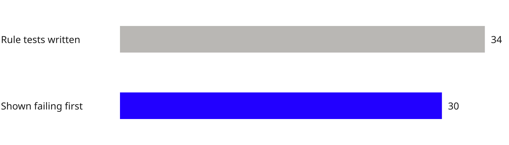

<!--
DRAFT DECK. Main deck: scene, business value, demo, cost. Detail and sources in the appendix.
Evidence: docs/research/research.md, docs/DEVIN-LOG.md, docs/SECURITY-REVIEW.md, devin.ai/pricing
(checked 2026-10-15). Rules: .agents/skills/slides/SKILL.md. Anything not measured is said so.
-->

<!-- _class: title -->
<!-- _paginate: skip -->

# Power Apps or build with Devin

Cost and controls, tested on three internal apps

<!-- _footer: "Prepared for the VP of Engineering · October 2026" -->

<!--
DRAFT. Title slide. The drawing is the idea in one picture: one shared core (sign-in,
permissions, audit, approvals, masking) and each business app plugs into it.
-->

---

<!-- _footer: "Source: client spend figure; Microsoft Power Apps pricing and licensing pages" -->

###### 01 · The scene

# Power Apps bills per user, so moving one app frees no seats

- $250K a year is about 1,042 seats at $20 a month
- Extra apps cost a licensed user nothing more
- From February 2027, unlicensed users are blocked

<small>Today</small>Uses 3 apps, pays 1 seat

<small>2 apps move</small>Still pays 1 seat

<small>All 3 move</small>Seat freed

<!--
DRAFT.
VP question: If we build our own apps, do we stop paying $250K?
What I'll say: Premium is per user with unlimited apps, so the saving isn't automatic. A seat is
only freed when every app that person uses has moved. 1,042 = $250,000 ÷ ($20 × 12), and assumes
the whole $250K is Premium seats at list price. From February 2027, people using apps in managed
environments without a licence are blocked, which could mean more seats, not fewer.
-->

---

<!-- _footer: "Source: Microsoft Learn on Approvals, column security and auditing; our database rules" -->

###### 02 · Business value

# Our build enforces the controls Power Apps leaves to each flow

| Control | Power Apps | *Our build* |
|---|---|---|
| No self-approval | No built-in check | Database rule, tested |
| Masked customer data | Admins bypass column security | Masked on the server, no bypass |
| Audit evidence | History kept, no native export | Append-only, same transaction |

<!--
DRAFT.
VP question: Why not keep everything on Power Apps?
What I'll say: these are the controls an auditor asks about for money movement and identity data.
Power Apps can get there, but each is left to whoever builds the flow, and the admin bypass on
masking can't be configured away. In our build the database refuses the bad write.
-->

---

<!-- _footer: "Source: our dev log (refunds session) and our security review. The demo uses dummy data only" -->

###### 03 · The demo

# In the demo, a senior user can't approve their own refund

- Sign-in through Keycloak, standing in for Entra
- 30 of 34 refund rule tests shown failing first
- Our attack review broke 3 areas; each is fixed

Demo still goes here once the video is recorded

<!--
DRAFT.
VP question: Does it work, and can we trust code Devin wrote?
What I'll say: walk the refund flow: request, try to self-approve, refused, a second approver
approves, the audit row appears. Data is fake. Every control is self-built, so assurance comes
from our tests and reviews; the hostile review broke three things and each got a failing test
and a fix (appendix).
-->

---

<!-- _footer: "Source: client figure; Microsoft and 2Data on price; devin.ai/pricing, 15 Oct 2026" -->

###### 04 · Cost

# Power Apps costs $250K a year; the pilot measures cost per app

| Cost | What we know | Measured in the pilot |
|---|---|---|
| Power Apps today | $250,000 a year | Who uses which app |
| Power Apps next year | One advisor reports $20 → $22 from January 2027 | Seats needed once unlicensed users are blocked |
| Building each app | Devin Teams: $80 a month plus $40 per seat | Devin usage and review hours per app |

<!--
DRAFT.
VP question: What does each path cost us?
What I'll say: today's figure is yours. Microsoft's own pages still show $20; the $22 is a
secondary source, so it isn't in any sum. The build side is not one seat per engineer: a small
team builds and reviews. Devin's list price is from devin.ai/pricing on 15 October 2026; usage
past the included quota is billed at API pricing, which the page doesn't state. The whole proof
of concept used $74.48 of on-demand usage, not split by app. No break-even claim until the pilot
fills the right-hand column.
-->

---

<!-- _class: appendix -->
<!-- _footer: "Source: our dev log, refunds session" -->

###### Appendix

# 30 of 34 refund rule tests were shown failing before the code

<!--
DRAFT. Only if asked. Test-first is the main evidence that the rules are real, not decoration.
-->

---

<!-- _class: appendix -->
<!-- _footer: "Source: client's spend figure; Microsoft pricing page; Thomas's billing total on 15 Oct 2026" -->

###### Appendix

# What we have measured on cost so far, and what we haven't

| Item | Value | How we got it |
|---|---|---|
| Implied Power Apps seats | About 1,042 | $250,000 ÷ ($20 × 12) |
| Devin usage, whole proof of concept | $74.48 | Billing running total, all apps together |
| Devin cost and review hours per app | Measured in the pilot | Needs a per-app billing split and a time log |
| Hosting per year | Measured in the pilot | Not researched yet |

<!--
DRAFT. Show the arithmetic if asked.
-->

---

<!-- _class: appendix -->
<!-- _footer: "Source: our security review and dev log" -->

###### Appendix

# Our own attack review broke three controls, now fixed

| Attack | What broke | Fix |
|---|---|---|
| Bulk unmasking | 50 of 50 emails revealed in 1 second | 20 reveals per hour per user |
| Refund splitting | £1,000 refunded as four £250 refunds | Unapproved total per payment capped |
| Hiding denials | A prefetch header skipped the audit row | Every page denial audited |

<!--
DRAFT. Only if asked. PRs #17, #18, #19.
-->

---

<!-- _class: appendix -->
<!-- _footer: "Source: our evaluation's open items" -->

###### Appendix

# Three things to do before the next app

| Step | Why | Owner |
|---|---|---|
| Test sign-in on a real Entra tenant | Keycloak stood in for Entra | [TBD] |
| Map which users use which apps | Shows which seats a move frees | [TBD] |
| Measure Devin cost and review hours per app | Fills the cost table | [TBD] |

<!--
DRAFT. Each step closes an open item in the evaluation.
-->

---

<!-- _class: appendix -->

<!-- _footer: "Source: every link and quote is in our research notes" -->

###### Appendix · Sources

# Every number in this deck comes from these sources

| Source | What it gives us | Slides |
|---|---|---|
| Client, and Microsoft's pricing and licensing pages | $250K spend, $20 list price, February 2027 blocking | 1, 4, 6 |
| Microsoft Learn, and 2Data licensing advisory | Control gaps; the reported $22 price | 2, 4 |
| devin.ai/pricing, checked 15 October 2026 | Teams $80 a month plus $40 per seat | 4 |
| Our dev log and security review | Tests, attack review, $74.48 usage | 3, 5–7 |

<!--
DRAFT. Full URLs and quotes are in docs/research/research.md.
-->
